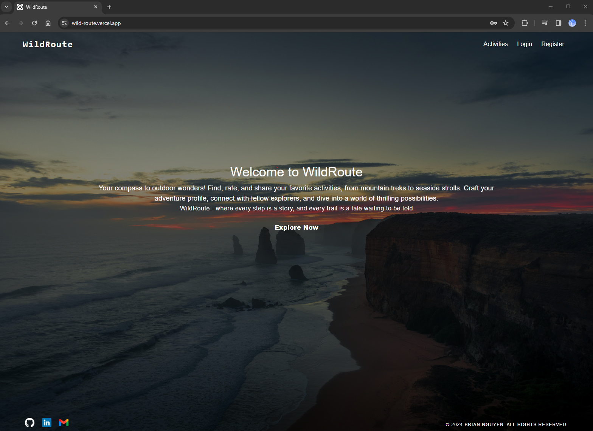
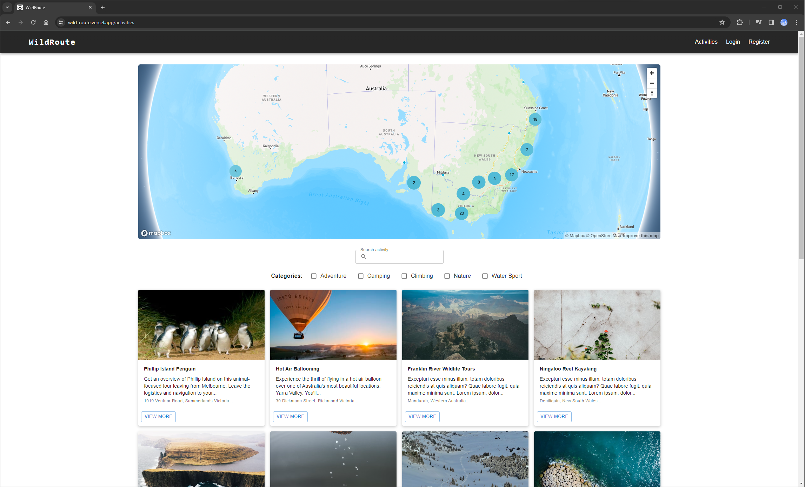
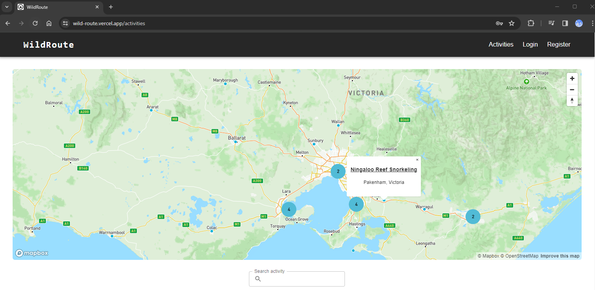
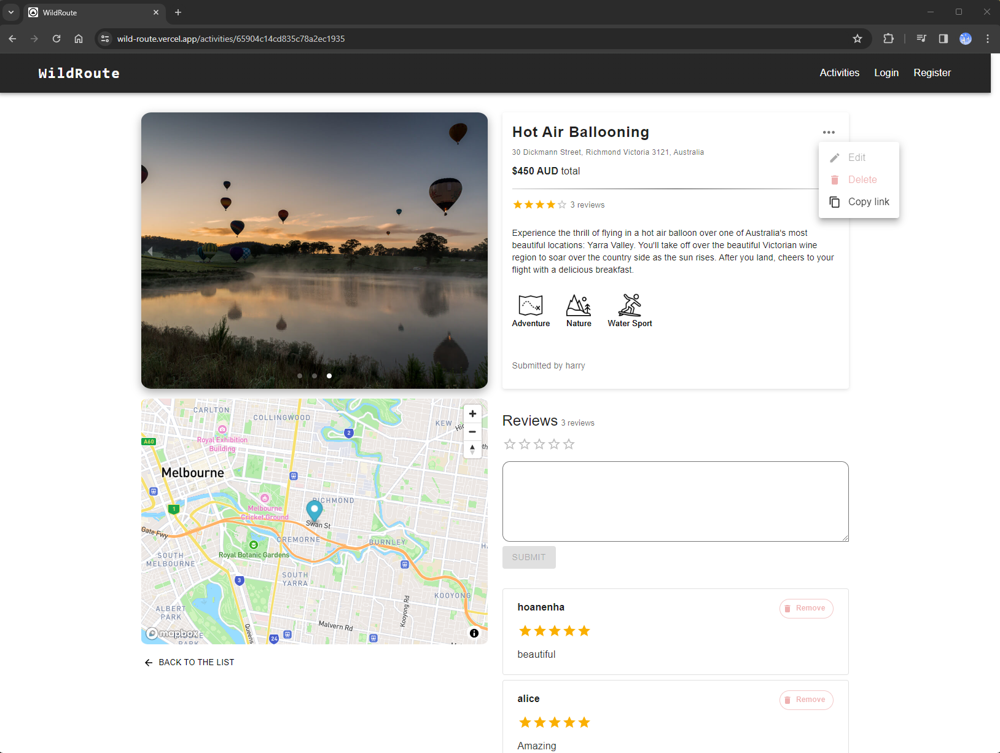
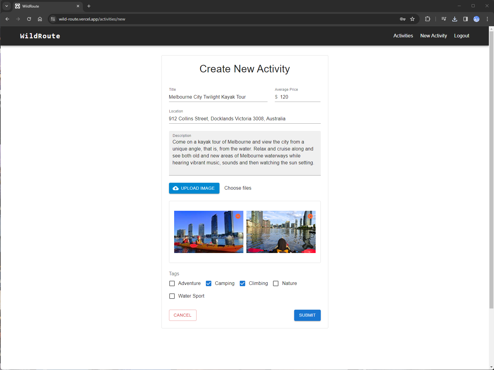
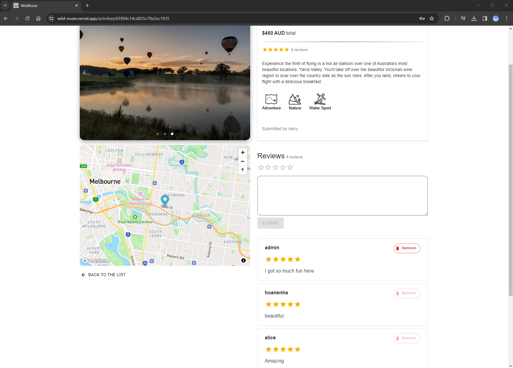

# WildRoute 🌿

**Discover and share outdoor adventures across Australia.**

WildRoute is a full-stack activity discovery platform where users can explore, create, and review outdoor activities — all plotted on an interactive map with precise location details.

🔗 **Live Demo:** [wild-route.vercel.app](https://wild-route.vercel.app/) &nbsp;|&nbsp; **API:** [wildroute-api.onrender.com](https://wildroute-api.onrender.com)

> **Try it out** — sign in with `admin` / `admin` or create your own account.

---

## Screenshots

| Home | Activity List | Interactive Map |
|------|--------------|-----------------|
|  |  |  |

| Activity Detail | Create Activity | Reviews |
|----------------|-----------------|---------|
|  |  |  |

---

## Features

- 🗺️ **Interactive Map** — All activities plotted on a live Mapbox map; updates in real-time as activities are added
- 🔍 **Search & Filter** — Search activities by name or category
- 📋 **Activity Listings** — Browse detailed activity cards with location, description, and images
- ✏️ **Full CRUD** — Authenticated users can create, edit, and delete their own activities
- ⭐ **Ratings & Reviews** — Leave feedback on any activity; only the review owner can delete it
- 🔐 **Authentication** — JWT-based auth with Passport.js; tokens stored in Redis for stateless invalidation
- 🔑 **Password Reset** — Self-service password reset flow
- 🖼️ **Image Uploads** — Activity photos uploaded via Multer and stored on Cloudinary
- 🛡️ **Input Sanitization** — Server-side Joi validation, `express-mongo-sanitize`, and `sanitize-html` protect against injection attacks

---

## Tech Stack

### Frontend
| Technology | Role |
|-----------|------|
| React 18 + TypeScript | UI framework |
| Vite | Build tool & dev server |
| React Router v6 | Client-side routing |
| Material-UI (MUI) | Component library & theming |
| Mapbox GL JS | Interactive maps |
| React Hook Form | Performant form handling |
| Axios | HTTP client |

### Backend
| Technology | Role |
|-----------|------|
| Node.js + Express + TypeScript | REST API server |
| MongoDB + Mongoose | Primary database & ODM |
| Redis | JWT token store (stateless logout) |
| Passport.js + JWT | Authentication strategy |
| Multer + Cloudinary | Image upload & storage |
| Joi | Request validation |

### DevOps & Tooling
| Technology | Role |
|-----------|------|
| Vercel | Frontend deployment |
| Render | Backend deployment |
| TypeScript (full stack) | End-to-end type safety |

---

## Architecture

```
┌─────────────────────┐        REST API        ┌──────────────────────────┐
│   React SPA         │ ──────────────────────▶ │   Express + TypeScript   │
│   (Vercel)          │ ◀────────────────────── │   (Render)               │
└─────────────────────┘      JSON responses     └──────────┬───────────────┘
                                                           │
                                          ┌────────────────┼────────────────┐
                                          ▼                ▼                ▼
                                       MongoDB           Redis          Cloudinary
                                    (activities,      (JWT tokens)    (user images)
                                     users, reviews)
```

- The **frontend** is a single-page React app served via Vercel, communicating with the backend over HTTPS.
- The **backend** exposes a RESTful API with route-level auth guards using Passport JWT middleware.
- **Redis** is used to store and invalidate JWT tokens, enabling true stateless logout without database lookups.
- **Cloudinary** handles image hosting, removing the need for local file storage in production.

---

## Getting Started

### Prerequisites

- [Node.js](https://nodejs.org/) v18+
- [MongoDB](https://www.mongodb.com/try/download/community) (local instance)
- [Redis](https://redis.io/download) (local instance)
- A [Mapbox](https://www.mapbox.com/) access token
- A [Cloudinary](https://cloudinary.com/) account

### Installation

```bash
# 1. Clone the repository
git clone https://github.com/Brian3010/WildRoute.git
cd WildRoute
```

**Backend**

```bash
cd backend
npm install

# Create .env file (see Environment Variables section below)

npm run serve        # dev mode with watch
# or
npm run build && npm start   # production build
```

**Frontend**

```bash
cd frontend
npm install

# Create .env file (see Environment Variables section below)

npm run dev          # starts Vite dev server
```

### Environment Variables

**`backend/.env`**
```env
PORT=3000
MONGO_URL=mongodb://localhost:27017/wildroute
REDIS_URL=redis://localhost:6379
JWT_SECRET=your_jwt_secret
CLOUDINARY_CLOUD_NAME=your_cloud_name
CLOUDINARY_API_KEY=your_api_key
CLOUDINARY_API_SECRET=your_api_secret
```

**`frontend/.env`**
```env
VITE_API_BASE_URL=http://localhost:3000
VITE_MAPBOX_TOKEN=your_mapbox_token
```

> Need help with environment variables? Reach out at [briannguyenwg@gmail.com](mailto:briannguyenwg@gmail.com).

---

## Usage

| Action | How |
|--------|-----|
| Browse activities | Visit the Activities page — no login required |
| View on map | Click the Map tab to see all activities geographically |
| Search | Use the search bar to filter by name or category |
| Create an activity | Sign in → click "New Activity" → fill in details + upload photos |
| Edit / Delete | Only available to the activity owner when signed in |
| Leave a review | Sign in → navigate to any activity → submit a review |

---

## Why This Project Matters

Outdoor activity discovery tools are often limited to trail databases with no community layer. WildRoute combines **user-generated content** with **geospatial discovery**, letting adventurers both find and share experiences in one place.

From an engineering perspective, the project demonstrates:

- **Full-stack TypeScript** across a decoupled frontend/backend architecture
- **Secure auth** using JWT + Redis (token invalidation without session storage)
- **Production deployment** with separate hosting for frontend (Vercel) and backend (Render)
- **Real-world integrations** with Mapbox, Cloudinary, and MongoDB Atlas

---

## Future Improvements

- [ ] OAuth login (Google / GitHub)
- [ ] Activity difficulty ratings and distance/elevation metadata
- [ ] Filter activities by map bounds (visible area search)
- [ ] Email notifications for reviews on owned activities
- [ ] Mobile-responsive UI improvements

---

## Author

**Brian Nguyen**

- 📧 [briannguyenwg@gmail.com](mailto:briannguyenwg@gmail.com)
- 💼 [LinkedIn](https://www.linkedin.com/in/brian-nguyen-411483196/)
- 🐙 [GitHub](https://github.com/Brian3010)
